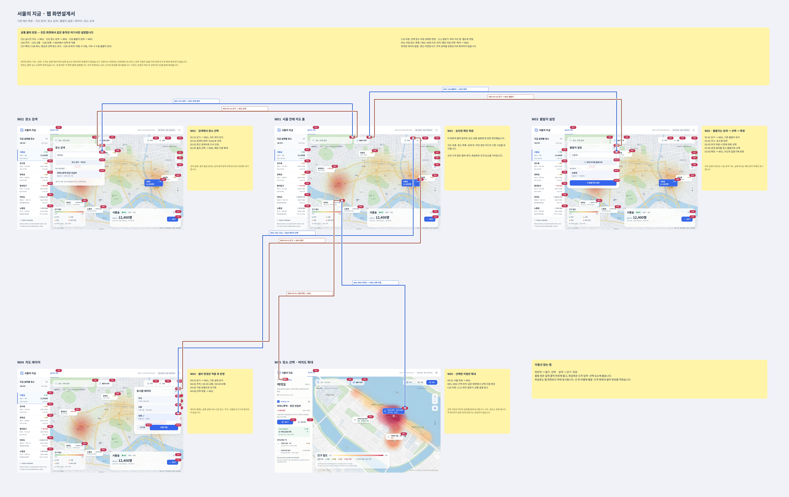

# 화면설계서 1차구현

서울의 지금 데스크톱 웹 화면설계서 초안입니다. 프론트엔드 개발 시 화면 구성과 화면 사이의 이동 흐름을 참고하기 위한 자료입니다.

[원본 해상도로 화면설계서 보기](desktop-web-v1.png)

## 포함된 화면

| 화면 | 내용 |
| --- | --- |
| W01 | 서울 전체 지도 홈 |
| W02 | 장소 검색 |
| W03 | 출발지 설정 |
| W04 | 지도 레이어 |
| W05 | 장소 선택 · 여의도 확대 |

화면 번호, 클릭 위치, 화면 이동 화살표 및 설명은 이미지에서 확인할 수 있습니다. 지도·인구 수치 등 이미지에 표현된 값은 화면설계 예시이며, 실제 서비스에서는 API 응답과 제공 상태에 맞춰 구현합니다.

원본 파일명: `서울의 지금 · 데스크톱 웹 화면설계서.png`

이 문서의 상태는 **1차 화면설계**입니다. 실행 가능한 React 화면의 구현 상태는 프로젝트 코드와 README를 기준으로 확인합니다.
